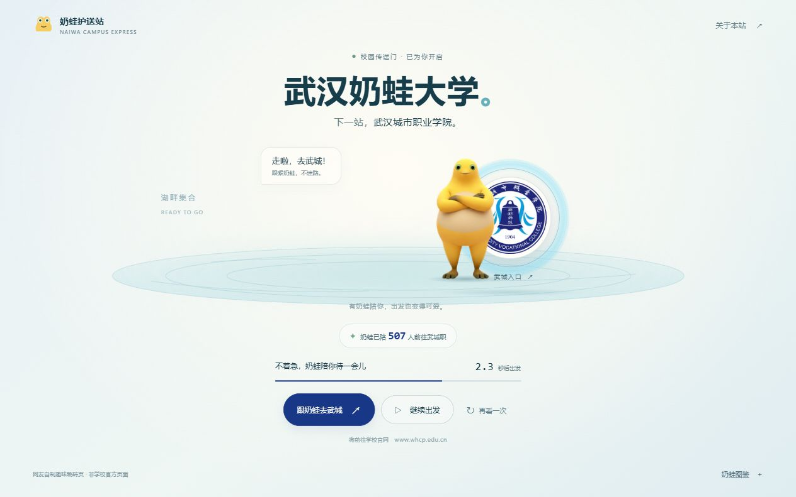

# 武汉奶蛙大学 · 奶蛙传送门

让奶蛙陪你走过湖面，穿过校徽传送门，下一站抵达武汉城市职业学院。

[在线体验](https://xn--psszg58cb73ap6a0z9g.icu/) · [停留预览](https://xn--psszg58cb73ap6a0z9g.icu/?stay=1) · [部署说明](docs/DEPLOYMENT.md) · [素材说明](THIRD_PARTY_NOTICES.md)



> 自制的校园趣味跳转页，与学校没有官方关联。截图中的人数是拍摄时的数据，在线数字由后台持续累计。

## 有什么

- 奶蛙走来、挥手、转身与进入校徽传送门的动画。
- 默认 7 秒后前往学校官网，支持暂停、继续和重新播放。
- 桌面与手机布局，支持系统减少动态效果偏好。
- 奶蛙图鉴、素材来源和非官方说明。
- “奶蛙已陪 xxx 人前往武城职”：Netlify Functions + Blobs 提供持久化的浏览器去重计数。
- 页面和图片保存在仓库中，不依赖第三方前端 CDN。

## 快速预览

需要 Node.js 22.12 或更高版本。

```sh
npm ci
npm run dev
```

打开终端给出的 `http://127.0.0.1:4173/?stay=1`。这是静态预览，人数会显示暂时无法获取；它不会伪造后台数据。完整计数需要 Netlify Functions 环境，详见[部署说明](docs/DEPLOYMENT.md)。

| 地址参数 | 效果 |
| --- | --- |
| 无参数 | 正常播放并自动跳转 |
| `?stay=1` | 播放到传送门开启时暂停，方便查看 |
| `?motion=reduce&stay=1` | 减少动态效果并停留 |

## 配置

编辑根目录 `site.config.json`，然后运行 `npm run build`。

| 字段 | 用途 |
| --- | --- |
| `targetUrl` | 跳转目的地，必须使用 HTTPS；前端与后台从同一配置读取 |
| `countdownSeconds` | 倒计时长度，范围 1–60 秒 |
| `counterSince` | 开始统计日期，格式 `YYYY-MM-DD` |
| `historicalBase` | 历史基数，现站为 `500`；新站请使用示例中的 `0` |

本仓库 `site.config.json` 保留现有演示站配置。创建你自己的新站时，请先将 `site.config.example.json` 复制为 `site.config.json`，从 0 开始，并修改开始日期。Netlify Functions 环境变量 `NAIWA_HISTORICAL_BASE` 可覆盖正式站历史基数；测试部署始终使用 0，并使用独立数据存储。示例配置不包含凭据或访客记录。

更换学校时，还需要编辑 `dist/index.html` 中的名称、按钮和说明文案，以及替换已获许可的校徽。当前动画视觉主题围绕“武城”制作。

## 人数怎样统计

人数表示发起前往学校官网的浏览器数量：自动倒计时结束或点击出发按钮才提交一次；仅浏览、刷新和重播不会增加人数。不能据此确认外部学校页面已成功加载。

匿名签名 Cookie 用于去重，后台只保存标识的哈希记录。应用不保存姓名、联系方式或 IP；托管平台可能另有常规访问日志。清除 Cookie、超过一年或更换浏览器会重新识别，不同域名的 Cookie 也相互独立。

网络中断、禁用 Cookie、过早离开页面或后台不可用时可能漏记。它是趣味站的轻量统计，不是身份核验或防刷系统。HTTP 请求次数不能换算为人数。

现有演示站的站长于 2026-10-14 提供累计总数 505，当时已有 5 条在线记录，因此补录历史基数 500；后续在线记录继续累计。这个基数保存在现站配置中；新站使用 `site.config.example.json`，基数为 0。

## 开发与验证

```sh
npm run build
npm test
```

测试覆盖重复浏览、并发去重、不同浏览器、分页统计、非法请求、存储故障、历史基数以及正式与预览环境隔离。

```text
dist/                  网页、样式、动画与本地图片
netlify/functions/     人数接口
netlify/lib/           计数逻辑与配置校验
scripts/               构建与本地静态预览
tests/                 Node.js 测试
docs/                  项目预览与 Netlify 部署说明
site.config.json       共用站点配置
```

`dist/site-config.js` 由构建脚本生成，请修改根配置后重新构建。GitHub 保存源码，网站继续由 Netlify 托管；无需启用 GitHub Pages。

## 素材与许可

项目在 Codex 辅助下制作。奶蛙动作、图片与校徽的来源见 [THIRD_PARTY_NOTICES.md](THIRD_PARTY_NOTICES.md)。公开仓库不代表对第三方素材授予统一使用许可。当前代码许可状态见 [LICENSE.md](LICENSE.md)。
